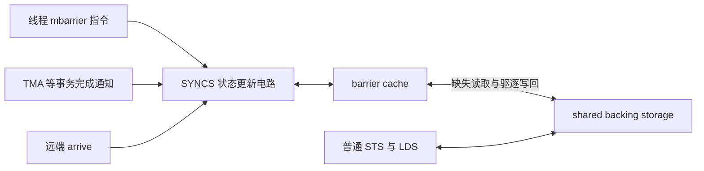

# mbarrier arena 复用与 SYNCS 缓存写回分析

本文分析 shared arena 从 barrier 存储改作输出数据时发生的损坏，记录 2026 年
10 月 21 日的复验和硬件机制实验。适用于阅读本目录复现代码、排查同类 arena
生命周期问题，以及理解 barrier cache 与 shared memory 的关系。

核心结论是：**新输出数据覆盖了旧 barrier 的 shared backing storage，但未
invalidate 的 barrier 仍可在同步硬件中保留状态。实验强烈支持该状态在缓存
驱逐时写回原地址，覆盖输出数据。** 双 CUDA context 是有效触发条件；同一
context 内增加其他 barrier 的访问压力也能独立触发，因此问题不限于抢占路径。

## barrier 状态与 shared backing storage

`mbarrier` 是位于 shared memory 的不透明同步对象，本实验使用 8 字节形式。
它逻辑上跟踪下列信息，不能将下面的字段表直接当成可编程的内存布局：

| 状态 | 含义 |
|---|---|
| phase | 当前同步轮次，供等待者区分前后两轮 |
| pending arrival count | 当前轮尚需到达的 arrive 数量 |
| expected arrival count | 下一轮装载的预期 arrive 数量 |
| transaction count | 当前轮跟踪的异步事务计数，例如 TMA 传输字节数 |

这些是 [PTX 对 mbarrier 内容的定义](https://docs.nvidia.com/cuda/archive/12.9.1/parallel-thread-execution/index.html#parallel-synchronization-and-communication-instructions-mbarrier-contents)。
无 TMA、count 为 1 时，可用下面的逻辑状态说明生命周期：

```text
init(1)        phase=0, pending=1, expected=1, tx=0
arrive()       pending 变为 0，完成条件满足
自动开始下一轮 phase=1, pending=1, expected=1, tx=0
wait(phase=0)  发现上一轮已完成，返回成功
```

完成上一轮后，barrier 仍是有效对象。所谓“旧 barrier 状态”，可以是这个对象
的最新状态；“旧”是相对于 shared 地址后来被复用为另一种数据而言。

shared backing storage 就是初始化 barrier 时提供的那组 shared 字节。
硬件对状态进行缓存，不会把原先的地址释放出来供普通数据安全使用。

## SYNCS 与 barrier cache

NVIDIA 的 [机器指令文档](https://docs.nvidia.com/cuda/cuda-binary-utilities/index.html)
将 `SYNCS` 标为 Sync Unit。本机反汇编也显示 barrier 操作进入这一指令路径：

| PTX 操作 | 本机 SASS |
|---|---|
| `mbarrier.init` | `SYNCS.EXCH.64` |
| `mbarrier.arrive` | `SYNCS.ARRIVE.TRANS64.A1T0` |
| `mbarrier.try_wait.parity` | `SYNCS.PHASECHK.TRANS64.TRYWAIT` |
| `mbarrier.inval` | `SYNCS.CCTL.IV` |
| 普通 shared store / load | `STS.64` / `LDS.64` |
| `fence.sc.cta` | `MEMBAR.SC.CTA` |

NVIDIA 的 [US12536056B2 专利中 Fig. 7 及 Hardware-Implemented Synchronization Unit 说明](https://patents.google.com/patent/US12536056B2/en)
描述了同步状态更新电路、barrier cache，以及等待跟踪和通知机制。部分实现使用
与 shared backing storage 不自动保持一致的 write-back cache：命中时在缓存
更新状态，缺失时从 backing storage 读取，驱逐时可将状态写回。
专利支持该机制模型，但不是本机芯片完整实现的公开规格。

下面是功能关系示意，不表示精确物理布局：



### 缓存内容与地址标记

barrier cache 缓存的是对象内容，即计数、phase 等字段的位编码，同时用地址
标记定位对象。它不是只记录一个地址是否可访问，也不是只保存一个指针。

```text
SYNCS 中的缓存项                     shared memory
┌───────────────────────────┐       ┌─────────────────────────┐
│ tag：标识 CTA 和地址 p      │       │ p：8 字节 backing storage│
│ valid：缓存项是否有效       │       └─────────────────────────┘
│ payload：barrier 状态 B     │                 ▲
└───────────────────────────┘                 │
              └──────────── 写回 B ────────────┘
```

缓存项有效与某一 phase 完成是两个不同概念。普通 shared store 修改 backing
storage，不代表它会自动更新或失效掉 SYNCS 内的 payload。payload 可以比
shared 副本更新，也可以在地址被违规复用后成为会覆盖新数据的遗留副本。

### 位置与 L1 和 shared memory 的关系

H100 的 L1、Texture cache 和 shared memory 共用 256 KB 的片上存储资源，
其中最多 228 KB 可配置为 shared memory。
见 [Hopper Tuning Guide](https://docs.nvidia.com/cuda/hopper-tuning-guide/index.html#unified-shared-memory-l1-texture-cache)。

按上述硬件模型，barrier cache 是同步单元的专用状态存储，与 shared backing
storage 是两份存储。它不是 CUDA 程序可直接寻址的另一块 shared allocation，
也不应理解为通用 L1、L2、HBM 数据缓存层级中的一个新层级。
公开资料和本次实验尚不足以确定本机的硅片布局、每 SM 是否独占，以及可能的
分区或跨 SM 共享方式。

### 访问成本与容量

缓存命中使同步状态更新免去访问 shared backing storage 的往返，并减少
shared 访问流量。这不能直接推出一条 `mbarrier` 指令比一条 `LDS` 延迟更低：
前者可能包含计数更新、完成判断和等待通知，后者只负责读取数据。
本次实验测量覆盖行为和替换阈值，没有获得可用于比较的指令延迟或吞吐数据。

下文的单 context 实验与“16 个区域、每个覆盖 16 B”的容量模型相容。若采用
这个模型，数据容量约为 256 B，可覆盖 32 个紧密排列的 8 B barrier。
这不是已确认的每 SM 总容量，也不包括 tag、有效位和等待跟踪的存储。
分区、地址映射和替换策略也可能影响观察到的阈值。

正常对象可以被驱逐并重新加载，所以该模型也不意味着只能创建 32 个 barrier。
超出缓存可驻留数量与违规复用 backing storage 是不同问题。

## 输出 tile 与旧 barrier 的地址重叠

本例的关键范围如下，区间右端不包含在内：

| 对象 | shared 字节范围 |
|---|---|
| 原 9 个 barrier 的 backing storage | `[159744, 159816)` |
| 新 dW 输出 tile | `[147456, 212992)` |
| 新 dW barrier | 从 `212992` 开始 |

旧 barrier 的 72 B 完全位于新输出 tile 内。两者不是仅仅“相邻”或意外越界，
而是 arena 在不同阶段被有意复用：

```text
147456                 159744    159816                   212992
   │                      │        │                        │
   │                      ├────────┤                        │
   │                      旧 barrier backing storage       │
   ├────────────────────────────────────────────────────────┤
                         新输出 tile
```

对其中一个地址 p，最符合实验的执行过程是：

| 时刻 | SYNCS 缓存 | shared memory[p] |
|---|---|---|
| barrier 完成一个 phase | 仍保留有效状态 B | barrier 的 backing 值 |
| 输出 writer 执行普通 store | B 未注销 | 新数据 D |
| 输出 reader 执行普通 load | 无需更新 B | 可以正确读到 D |
| 缓存项被驱逐并写回 | B 被写回原地址 | D 被 B 覆盖 |

“同步状态”和“输出数据”是同一组字节的两种解释。换指针类型或写入 BF16
不会自动通知同步硬件，该地址的旧对象已经结束生命周期。

## 实测证据

### 环境与统计口径

测试日期为 2026 年 10 月 21 日，设备名 NVIDIA L20X，driver 570.148.08，
nvcc 12.9.86，编译目标 SM90a。`cudaGetDeviceProperties` 报告 capability 9.0、
132 SM、每 SM 233472 B shared；该环境的 `nvidia-smi` capability 查询却报告
8.9。此处 SM90 信息依据 CUDA runtime 查询和成功执行的 SM90a binary。

GPU 0 用于最小程序、状态和缓存压力实验；GPU 1 用于流水线实验。开始测试时
`nvidia-smi` 未显示其他 GPU 进程。未重跑原生 PF 或 RL 训练；它们的历史结果
保留在 [README](README.md)。

### 最小程序与流水线复验

重新编译后的 [minimal.cu](minimal.cu) 每个进程运行 300 次 kernel、每次最多
保持 10 ms。独占未出现错误；双 context 的三轮中，未 invalidate 每轮均损坏
1188/1188 个槽位，invalidate 对照及竞争进程均为零。
槽位是 CTA 与 barrier 索引组合的累计去重统计，不是错误事件次数。
见 [原始结果](results_context_minimal_20261021.jsonl)。

[repro.cu](repro.cu) 使用 cluster2、132 CTA、steps256、GEMM 开启、256 个
输出 tile；每项 probe 100 次、正确协议 peer 200 次 kernel：

| drain | invalidate | 坏 BF16 元素 | 非有限元素 |
|---:|---:|---:|---:|
| 0 | 0 | 2940 | 1470 |
| 1 | 0 | 3176 | 1588 |
| 0 | 1 | 0 | 0 |
| 1 | 1 | 0 | 0 |

坏值全部位于旧 barrier 区域，GEMM accumulator 检查和所有 peer 均正常。
见 [原始结果](results_context_stream_20261021.jsonl)。不同运行的损坏数量受
调度影响，不能据此比较 drain 的优劣。编译有 WGMMA 串行化提示，该程序用于
正确性诊断，不作为性能 benchmark。

### 改变旧状态会改变覆盖值

[state_probe.cu](state_probe.cu) 只有一个 CTA、一个操作线程、一个 8 B barrier
和两侧各一个 8 B guard，共 24 B shared。完成指定数量的 phase 后覆盖目标，
再反复读取；覆盖后没有目标 barrier 操作或其他 shared writer。双 context
竞争进程使用正确的 invalidate 协议。

每项 100 次 kernel，每次最多保持 20 ms：

| 场景 | count | 完成 phase 数 | 损坏 kernel 数 | 覆盖后的坏值 |
|---|---:|---:|---:|---|
| 独占，未 invalidate | 1 | 1 | 0 | — |
| 双 context，从未初始化 barrier | — | — | 0 | — |
| 双 context，未 invalidate | 1 | 1 | 99 | `0xfffff800001ffffe` |
| 双 context，未 invalidate | 1 | 2 | 100 | `0x7ffff800001ffffe` |
| 双 context，未 invalidate | 7 | 1 | 100 | `0xffffc800001ffff2` |
| 双 context，未 invalidate | 7 | 2 | 100 | `0x7fffc800001ffff2` |
| 双 context，invalidate | 1 | 1 | 0 | — |
| 双 context，invalidate | 7 | 2 | 0 | — |
| 双 context，只加 CTA fence | 1 | 1 | 100 | `0xfffff800001ffffe` |

所有 guard 和竞争进程均正常。保存的错误样本显示，新数据可以先被正确读取
数万次；多个样本在首次错误附近有约 2.41 ms 的计时间隔。该间隔与执行暂停
相容，但不能作为直接的 context-switch trace，也不能定位实际写回时刻。
见 [原始结果](results_state_20261021.jsonl)。

新数据保持不变，坏值却随旧 barrier 的 count 和 phase 变化，强烈支持覆盖
内容来自保留的 barrier 状态。这四种坏值满足本机观测公式：

```text
q = 2^20 - count
word = ((completed_phases & 1) << 63) | (q << 43) | (q << 1)
```

该公式仅适用于此处已观测的状态，不是公开 ABI，也不用于生产代码构造对象。

### 单 context 的缓存压力实验

[cache_probe.cu](cache_probe.cu) 在一个 context、一个 CTA、一个操作线程内，
覆盖旧 barrier 的地址，再依次初始化并完成其他地址的 barrier，每步检查目标。
没有 TMA、远端写入或第二个应用 context。

共 280 项配置，每项 20 次 kernel，合计 5600 次。其他 barrier 数量从 0 到
1024，间隔为 8、16、32、128 B。
见 [原始结果](results_cache_20261021.jsonl)。

| 条件 | 结果 |
|---|---|
| 目标未 invalidate，其他 barrier 间隔 8 B | 第 31 个后目标被覆盖 |
| 目标未 invalidate，间隔 16、32、128 B | 第 16 个后目标被覆盖 |
| 目标提前 invalidate | 所有配置无错误 |
| 目标从未初始化为 barrier | 所有配置无错误 |
| 压力改为其他地址的普通 shared store | 所有配置无错误 |
| 每个施压 barrier 完成后立即 invalidate | 所有配置无错误 |

达到阈值的配置均为 20/20 次覆盖，首次变化位置的最小值和最大值相同；未到
阈值没有错误。覆盖值均为 `0xfffff800001ffffe`；施压前目标和所有 guard 正常。

单 context 的结果排除了“必须发生 context 切换才能触发”的解释。稳定的地址
数量阈值、旧状态位模式以及及时 invalidate 施压对象的对照，共同强烈支持
barrier 缓存容量压力造成驱逐写回。

16 B 区域模型能解释两个阈值：8 B 间隔的前 30 个施压对象占 15 个区域，第
31 个进入第 16 个新区域；间隔至少 16 B 时，第 16 个对象已经触及第 16 个
新区域。加上目标区域后发生替换。guard 未损坏说明不能假定写回会盲目覆盖
邻接的全部 16 B。

## context 竞争为何容易触发

暂停和恢复执行需要保全同步状态；一种与现象相容的机制，是保存 shared
memory 前先将 barrier 缓存写回，另一种是单独保存同步状态并在后续物化。
目前没有内部 trace 区分这些路径。恢复执行后读到损坏，不代表覆盖一定发生
在恢复阶段，保存前的写回已经足以导致问题。

原流水线的 9 个旧 barrier 占 5 个对齐 16 B 区域，12 个新 barrier 占 6 个，
另有 join 对象。仅按这些对象估算约 12 个区域，在上述容量模型下可能不足以
驱逐旧项，因而独占长跑可能始终不触发。context 竞争可能强制写回该状态。
这解释了触发条件，但具体抢占保存或恢复步骤仍是推断。

## 坏值与输出位置的对应

将实测的 `0xfffff800001ffffe` 按小端 BF16 拆分：

| BF16 bits | 数值 |
|---|---|
| `0xfffe` | NaN |
| `0x001f` | 约 `2.8469e-39` |
| `0xf800` | 约 `-1.038459e34` |
| `0xffff` | NaN |

NaN 与巨大有限值由同步状态的位编码直接产生。地址也能对上：

```text
旧 barrier 相对输出 tile 的偏移 = 159744 - 147456 = 12288 B
N64 atom 每行大小              = 64 × 2 = 128 B
对应行                         = 12288 / 128 = 96
9 个 barrier 覆盖 BF16 数量     = 9 × 8 / 2 = 36
```

因此覆盖位置为该布局下 tile 内第 96 行的 36 个 BF16，与原问题一致。

## 正确复用顺序

需要先完成并停止所有对旧 barrier 的事务、arrive 和 wait，按参与范围同步，
由指定线程 invalidate 所有将被覆盖的旧 barrier，再同步后由输出 writer
复用对应地址。涉及 cluster 时还要保证远端访问也已经结束。

drain 负责结束在途工作，invalidate 负责结束对象生命周期。CTA fence 或
普通 shared store 不能代替 invalidate；invalidate 也不能取消仍在途的操作。
[PTX 明确要求存储改作其他用途前 invalidate](https://docs.nvidia.com/cuda/archive/12.9.1/parallel-thread-execution/index.html#parallel-synchronization-and-communication-instructions-mbarrier-inval)。

## 复现与证据入口

在本目录执行。最小、状态和缓存压力程序只需要 CUDA：

```bash
make build/minimal build/state_probe build/cache_probe
python run_context.py --device 0 --trials 3
python run_state.py --device 0
build/cache_probe 0
```

`state_probe` 的 mode 0/1/2/3 分别表示从未初始化目标、旧协议、invalidate、
仅 CTA fence。`cache_probe` 的 mode 0/1/2 同理，mode 3 表示普通 store 压力，
mode 4 表示每个施压 barrier 完成后立即 invalidate。

最小和状态程序以退出码 2 报告数据损坏，以 1 报告运行或配置失败；
`cache_probe` 成功完成测量时退出 0，由 JSON 中的计数报告覆盖情况。

本机流水线重编译使用 flashinfer 附带的 CUTLASS：

```bash
make -B build/repro CUTLASS_PATH=/usr/local/lib/python3.12/dist-packages/flashinfer/data/cutlass
# 示例：probe 与正确协议 peer 在 GPU 1 上并发，分别使用独立 context。
build/repro 2 0 256 100 0 0 1 1 256 &
build/repro 2 0 256 200 1 1 1 1 256 &
wait
```

四份 `results_*_20261021.jsonl` 分别保留最小程序、流水线、状态变化和缓存
压力实验的原始输出。总体证据强度为：地址重叠和数据覆盖已实测；缓存驱逐
写回得到强实验证据和公开硬件方案支持；准确物理布局、总容量、延迟和
context 切换内部步骤尚未确认。
